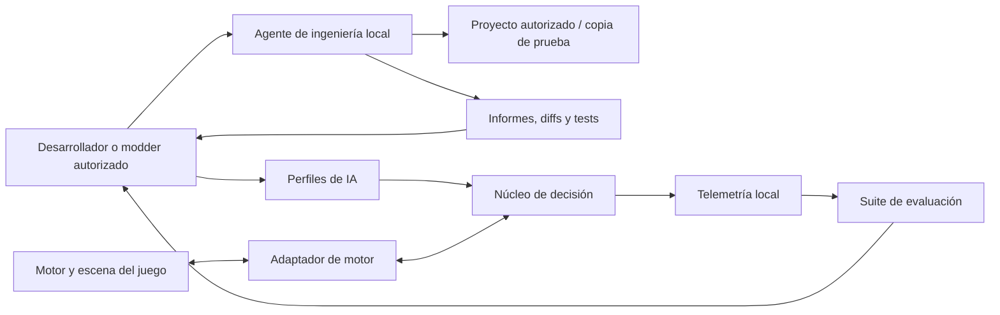
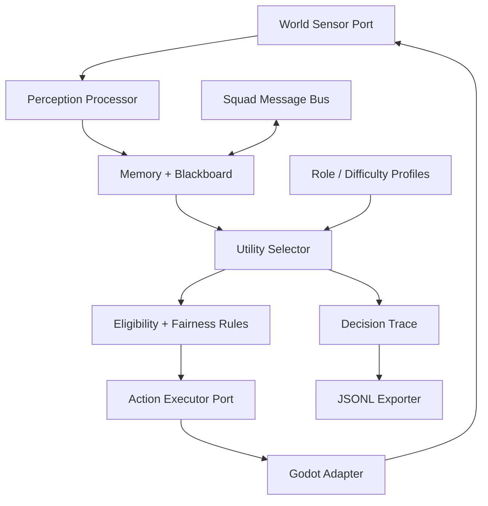

# 03. Arquitectura del sistema

## Modelo de dos planos

- **Plano de ejecución (runtime, dentro del juego):** percepción -> memoria/blackboard -> planificador de utilidad -> restricciones de justicia -> ejecutor de acciones -> navegación/animaciones; recibe datos únicamente del adaptador de motor.
- **Plano de ingeniería (fuera del juego):** agente local -> herramientas para inspección y documentación -> generación de recomendaciones/diffs -> validación/QA -> revisión humana. **No participa de decisiones de combate en vivo.**

## Diagrama de contexto

## Diagrama de componentes del runtime

## Componentes y responsabilidades

| Componente | Entrada | Salida | Restricción |
|---|---|---|---|
| `SensorPort` | Estado observado permitido | `Stimulus` | No filtrar posiciones invisibles |
| `PerceptionProcessor` | Estímulos crudos | Observaciones validadas | LOS, sonido, incertidumbre |
| `MemoryStore` | Observaciones y mensajes | Hechos con fuente/confianza/TTL | Caducidad y degradación |
| `Blackboard` | Contexto de rol/objetivo | Estado contextual | Propiedad por agente |
| `UtilitySelector` | Acciones elegibles y contexto | Acción + score + motivo | Pura/determinista cuando es posible |
| `SquadCoordinator` | Solicitudes y mensajes | Intenciones/reservas de cobertura | Comunicación plausible |
| `ActionPort` | Orden de alto nivel | Estado iniciado/terminado/fallido | Cancelación y fallback |
| `DifficultyPolicy` | Perfil de dificultad | Pesos, tiempos, error perceptivo | No «wallhack» |
| `Telemetry` | Eventos de todos los módulos | JSONL y resumen | Sin datos personales |

## Contratos y límites de confianza

- **Entradas de mundo:** `visible_targets`, `audible_events`, `reachable_points`, `own_status`. Los datos de verdad completa del mundo, si existen para QA, van en una interfaz diferente y nunca llegan al planificador en producción.
- **Orden de decisión:** 1) recoger observaciones autorizadas; 2) actualizar memoria; 3) calcular acciones elegibles; 4) obtener scores; 5) aplicar reglas duras; 6) elegir acción; 7) ejecutar; 8) registrar evento.
- **Cadencia:** percepción por eventos o muestreo acotado, decisión estratégica cada 200–500 ms como hipótesis inicial y movimiento/animaciones a frecuencia normal del motor; medir y ajustar.
- **Fallback:** si no hay acción válida, `HoldPosition` / `InvestigateSafe` / `Patrol` según el estado, nunca acciones con coordenadas no verificadas.

## Dependencias propuestas

- `src/NpcAnything.Core/` — C# sin Godot ni Unity; decisiones, memoria, interfaces, perfiles.
- `src/NpcAnything.Godot/` — adaptador para sensores, rutas, ejecución, telemetría.
- `demo/GodotArena/` — mapa y arte mínimo.
- `tests/Core.Tests/` y `tests/Integration/` — lógica y escenarios.
- `tools/agent/` — Python local, herramientas de diagnóstico y orquestación.
- `tools/bench/` — runner, comparador y exportación de métricas.

## Flujo de eventos y trazabilidad

Cada decisión lleva `run_id`, `scenario_id`, `npc_id`, `tick`, `profile_hash`, `candidate_scores`, `chosen_action`, `reason_code` y `knowledge_sources`. Cada estímulo incluye tipo, origen, tiempo y precisión aproximada. La telemetría escribe en un directorio de prueba configurable, no en instalaciones de terceros.

## Observabilidad y medición

Debe existir un modo overlay de depuración con percepción activa, últimos hechos recordados, objetivo actual, acción elegida y las tres puntuaciones principales. Los registros JSONL se agregan por escenario, rol, perfil y dificultad. No confundir latencia de decisión con FPS: medir ambos.

## Diseño para portabilidad

Los módulos Core no deben conocer `Node3D`, `GameObject`, `Actor`, `Transform` ni APIs de navegación específicas. Un adaptador convierte vectores, raycasts, rutas y comandos al formato común. Primero se prueba el núcleo con datos sintéticos y solo después se valida dentro de la escena.

## Amenazas arquitectónicas

Acoplamiento al motor, oscilación de objetivos, fuga de conocimiento global, saturación de CPU al consultar cobertura, mensajes instantáneos irreales, caminos no alcanzables, acciones sin finalización, logs no deterministas, prompt injection en textos que lee el agente y modificaciones a archivos originales. Se mitigan con contratos, throttling, histéresis, pruebas y workspaces aislados.

## Evolución prevista

- **v0.1:** Utility AI + reglas, Godot, agente de lectura.
- **v0.2:** adaptador Unity, mayor biblioteca de escenarios, agente de propuestas de parche.
- **v0.3:** API para plugins de juegos con modding documentado, GUI, métricas extendidas.
- **Investigación futura:** entrenamiento RL/imitación y planificación jerárquica, solo si demuestra valor adicional frente al baseline.
