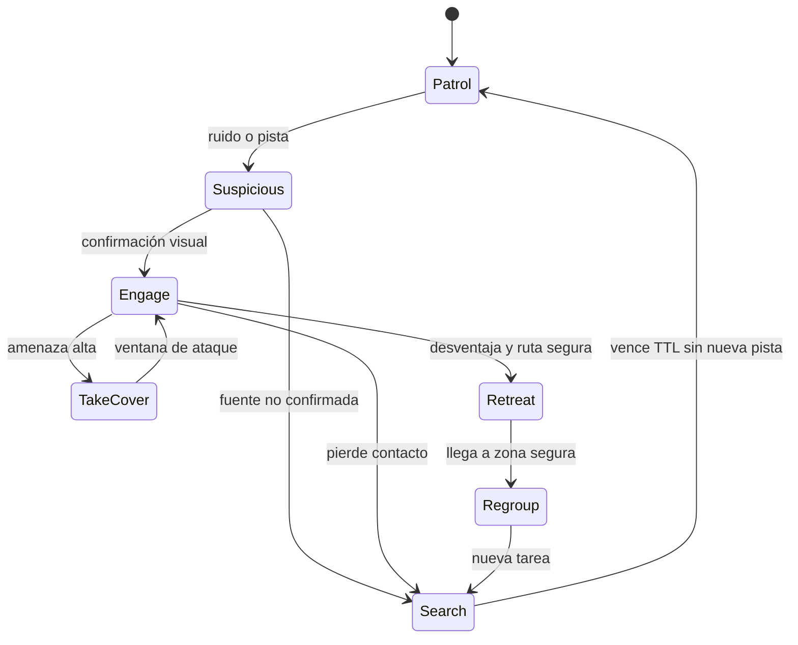

# 04. Diseño del comportamiento inteligente de NPC

## Principios operativos

La inteligencia se medirá por **decisiones oportunas, información plausible, coherencia de rol, respuesta legible y costo computacional**, no solo por capacidad de derrotar al jugador. El objetivo no es una IA perfecta. El error, la incertidumbre y las limitaciones forman parte del diseño.

## Percepción con conocimiento acotado

Cada NPC mantiene un conjunto de hechos de la forma `(entidad, posición_estimada, fuente, visto_en, confianza, precisión, TTL)`. Una observación visual válida requiere rango, cono de visión, línea de visión y, cuando aplique, iluminación/ocultamiento. Una señal auditiva entrega una región o centro aproximado, no las coordenadas exactas del emisor. Los mensajes de escuadrón transportan el conocimiento del emisor y pueden llegar con retraso.

Ejemplo de degradación: al perder visión directa, la confianza baja de 1.0 progresivamente; la incertidumbre espacial crece; al expirar TTL el NPC sabe que hubo contacto previo, pero no posee la posición exacta actual. La fórmula exacta se parametriza y valida con escenarios.

## Máquina de estados de alto nivel

La máquina de estados restringe contextos; dentro de cada estado, Utility AI elige acciones elegibles. Esto evita mezclar una única puntuación con transiciones imposibles.

## Selector de utilidad

Para cada acción elegible `a`, calcular una puntuación normalizada:

`U(a) = clamp(Σ_i w_i * f_i(contexto) + bonus_rol + bonus_objetivo - penalización_riesgo - penalización_cambio, 0, 1)`.

Las funciones `f_i` deben estar documentadas, acotadas a [0, 1], sin acceso a estado secreto. Aplicar **histéresis**: cambiar de acción solo cuando el nuevo score supera al actual por un margen o cuando el actual ya no es elegible. Aplicar **cooldowns** a retiradas, flanqueos y cambios de cobertura para reducir oscilaciones.

### Ejemplo de criterios de cobertura

- Cobertura protege frente a última amenaza estimada: peso 0,35.
- Punto alcanzable y de costo bajo: peso 0,25.
- Separación de aliados y ausencia de reservas: peso 0,20.
- Línea de fuego desde la cobertura: peso 0,10.
- Coherencia con objetivo de rol: peso 0,10.

Los pesos son valores iniciales para experimentar, no una optimización probada. Si un punto no es alcanzable, la acción se descarta, aunque su score sea alto.

## Roles mínimos

| Rol | Objetivo primario | Prefiere | Evita | Señal observable |
|---|---|---|---|---|
| Asalto | Mantener presión | Cobertura cercana y avance por ventanas | Exposición prolongada | Orden breve / movimiento |
| Flanqueador | Cambiar ángulo de amenaza | Ruta lateral con riesgo aceptable | Flanqueo suicida | Separación e indicación de ruta |
| Apoyo | Dar oportunidad al equipo | Fuego de supresión abstracto y posiciones seguras | Abandonar compañeros sin causa | Voz / animación de apoyo |
| Explorador | Detectar e informar | Observación y rutas discretas | Combate frontal innecesario | Aviso y marcaje visible |
| Compañero | Apoyar decisiones del jugador | Aviso, seguimiento y cobertura defensiva | Robar objetivos, bloquear paso | Llamados informativos |

## Coordinación de escuadrón

Protocolo propuesto: `CONTACT_ESTIMATED`, `REQUEST_COVER`, `COVER_RESERVED`, `FLANK_INTENT`, `REGROUP`, `RETREAT`. Un escuadrón no comparte visión de manera mágica: la entrega depende del canal, radio, distancia o voz definidos. Los mensajes poseen timestamp, expiración y confianza. La reserva de cobertura evita que dos agentes intenten ocupar el mismo punto simultáneamente; expira o se libera al morir, cancelar o terminar la acción.

## Dificultad sin trampas

| Parámetro | Fácil | Normal | Difícil | Experto |
|---|---|---|---|---|
| Retardo de reacción | Mayor | Medio | Menor | Menor con límite |
| Error auditivo | Mayor | Medio | Menor | Menor, no cero |
| Frecuencia de coordinación | Baja | Media | Alta | Alta y disciplinada |
| Riesgo permitido | Conservador | Equilibrado | Táctico | Contextual |
| Persistencia de búsqueda | Baja | Media | Alta | Alta pero finita |
| HP/daño | Constante | Constante | Constante | Constante |

Todos los valores concretos deben probarse en escena para evitar dificultad injusta o simplemente más rápida. Especificar límites inferiores de tiempo de respuesta humano-legible.

## Diseño del compañero

Jerarquía de prioridades: 1) no bloquear al jugador; 2) evitar peligro inmediato; 3) obedecer orden explícita si es válida; 4) avisar cuando tiene información útil; 5) cubrir al jugador sin apropiarse del objetivo; 6) seguir con distancia. Opcionalmente soportará órdenes `FOLLOW`, `HOLD`, `ASSIST`, `REGROUP`. Nunca debe usar información que su propio sensor no tenga.

## Fallos esperados y recuperación

- Ruta bloqueada -> marcar objetivo fallido y solicitar otro punto.
- Fuego amigo probable -> suspender ataque o cambiar posición.
- Comunicación interrumpida -> operar con información propia.
- Objetivo expirado -> regresar a búsqueda o patrulla.
- No hay cobertura -> alejarse de línea de fuego o mantener posición prudente.
- Acción activa sin progreso -> timeout y fallback auditable.

## Experimentos mínimos

E1 pérdida de línea visual; E2 dos caminos laterales y cobertura; E3 comunicación con y sin canal; E4 enemigo aislado y otro en escuadrón; E5 compañero y pasillo estrecho; E6 cuatro dificultades, HP/daño sin cambios. Para cada uno guardar semilla, video opcional, telemetría y reporte.
