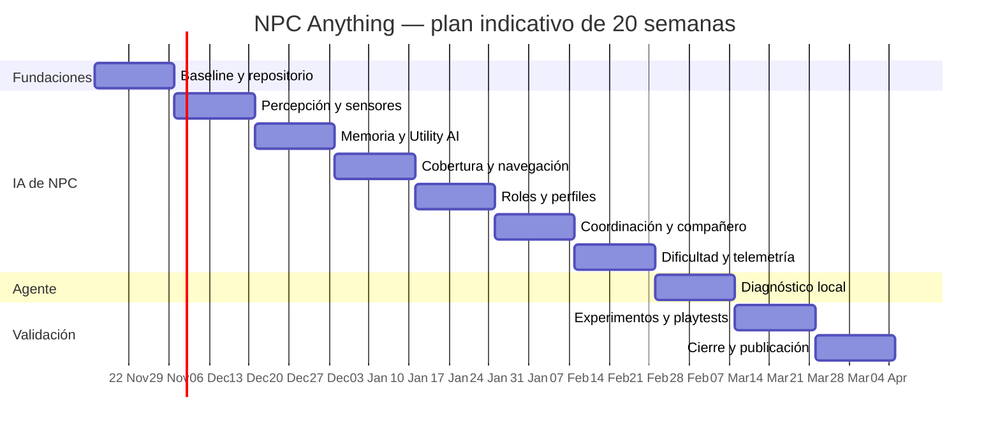

# 18. Vista Gantt referencial y entregas

## Gantt de 20 semanas, relativo al inicio del proyecto

Las semanas se numeran de 1 a 20 **desde el inicio efectivo**, sin fijar una fecha de calendario ficticia. La carta es orientativa y debe actualizarse según capacidad y revisión de gates.

**Importante:** la fecha `2026-11-16` del diagrama sirve únicamente para que Mermaid pueda dibujar barras consecutivas; **no es un inicio acordado**. El plan operativo definitivo debe basarse en una fecha aprobada.

## Matriz de hitos

| Hito | Semana | Dependencia | Resultado |
|---|---:|---|---|
| G0 | 2 | Baseline | Primer build reproducible |
| G1 | 4 | Sensor | Percepción sin omnisciencia |
| G2 | 6 | Memoria | Selector explicable |
| G3 | 8 | Navegación | Cobertura y fallback |
| G4 | 10 | Roles | Comportamientos diferenciados |
| G5 | 12 | Escuadrón | Comunicación y aliado |
| G6 | 14 | Instrumentación | A/B con semilla |
| G7 | 16 | Herramientas | Diagnóstico local |
| G8 | 18 | QA | Resultados exploratorios |
| G9 | 20 | Cierre | Demo y release candidate |

## Ruta alternativa para baja disponibilidad

Si solo hay 8–10 h/semana, mantener el horizonte de 20 semanas pero recortar los objetivos: dos roles enemigos, sin companion completo, agente read-only como documento de diseño, 5–6 escenarios en lugar de 12; extender la evaluación y declarar explícitamente el alcance reducido. No incrementar de forma implícita horas extra.
